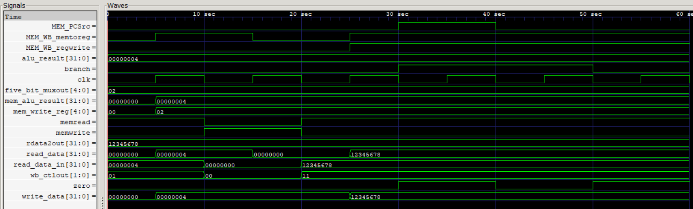
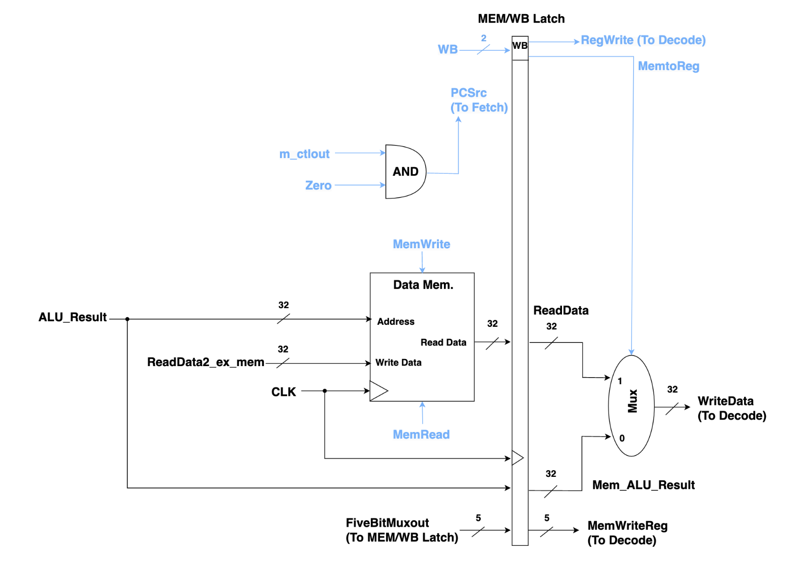
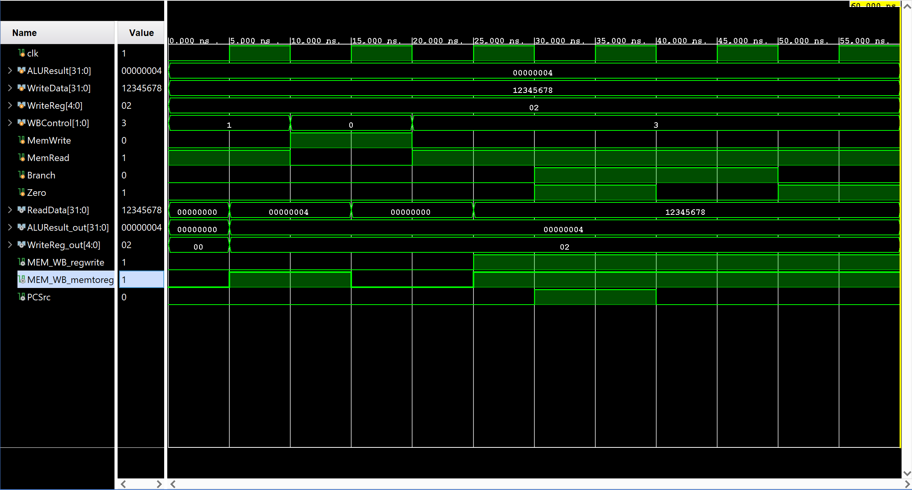

# Coding Assignment 4 -  Memory and Writeback
<!--
Replace every item in square brackets before submitting.
Keep this README focused on what the design does, how it is used, and how it was
verified.
-->
## Design Scope and Assumptions
- **In scope:** The Memory and Writeback (MEM/WB) stages of the MIPS pipeline are implemented. The memory state ANDs the Branch control bit with the ALU Zero flag to produce PCSrc for the fetch stage, reads or writes the data memory, and stores the results in the MEM/WB latch. The write-back stage uses a mux to choose the value that is written back to the register file.
- **Out of scope:** Connecting all five stages into one complete pipeline, and hazard handling such as forwarding and stalls.
- **Assumptions:** 32-bit data and addresses. The data mem has 256 words, and the address from the ALU is used directly as the word index, so address 4 would refer to word 4. The data memory writes on the rising clock edge and reads combinationally. The MEM/WB latch captures on the rising clock edge. The memory control bits come in as separate branch, memread, and memwrite signals from the EX/MEM latch. Every word starts out equal to its index (0-255), and data.txt then loads words 0-5. The testbench clock has a 10 ns period.
- **Limitations:** Addresses of 256 or more are out of range, so reads return unknown and writes are ignored. Only whole 32-bit words can be accessed, with no byte or halfword access.

## Requirements
| Requirement | Description | Verification Method |
|---|---|---|
| REQ-01 | The memory stage shall set PCSrc to 1 only when both Branch and Zero are 1 | Waveform |
| REQ-02 | When MemRead is 1, the data memory shall output the word stores at the address given by the ALU result | Waveform |
| REQ-03 | When MemWrite is 1, the data memory shall store ReadData2 atthe ALU-result address on the rising clock edge | Waveform |
| REQ-04 | The MEM/WB latch shall capture RegWrite, MemToReg, ReadData, the ALU result, and the write register number on the rising clock edge | Waveform |
| REQ-05 | The write-back mux shall output ReadData when MemtoReg is 1 and the ALU result when MemToReg is 0| Waveform |
| REQ-06 | The memory stage module shall contain the AND gate, the data memory, and the MEM/WB latch | memory.v inspection and the overall testbench|

## Architecture
### Timing or Behavioral Summary
In the memory stage, the AND gate combines Branch (from the EX/MEM latch) with Zero to create PCSrc, which goes back to the fetch stage's mux. At the same time, the data memory uses the ALU result as its address. A load (MemRead = 1) puts the word at that address on read_data, and a store (MemWrite = 1) writes ReadData2 into that address on the rising clock edge. On the same clock edge, the MEM/WB latch captures the control bits, the memory data, the ALU result and the write reg number. 
In the write-back stage, a mux controller by MemToReg picks between thedata read from memory (loads) and the ALU result (R-type instructions). Its output goes back to the register file in the decode stage, along with RegWrite and the write register number.



## Implementation
### Source Code
| File | Description |
|---|---|
| [`AND.v`](https://github.com/isabellalaurenn/codingAssignment4-MW/blob/main/AND.v) | ANDs Branch and Zero to product PCSrc |
| [`data_memory.v`](https://github.com/isabellalaurenn/codingAssignment4-MW/blob/main/data_memory.v) | 256-word data memory. Stores on the clock edge and reads combinationally |
| [`memory.v`](https://github.com/isabellalaurenn/codingAssignment4-MW/blob/main/memory.v) | Connects the AND gate, data memory, and MEM/WB Latch |
| [`memory_tb.v`](https://github.com/isabellalaurenn/codingAssignment4-MW/blob/main/memory_tb.v) | Testbench for the full memory stage |
| [`mem_wb_latch.v`](https://github.com/isabellalaurenn/codingAssignment4-MW/blob/main/mem_wb_latch.v) | Pipeline latch, clocked on the rising edge |
| [`writeback.v`](https://github.com/isabellalaurenn/codingAssignment4-MW/blob/main/writeback.v) | Writeback stage. Mux that selects the data written back to the register file |
| [`data.txt`](https://github.com/isabellalaurenn/codingAssignment4-MW/blob/main/data.txt) | Initial contents of data memory words 0-5 |

### Implementation Notes
- The data memory writes on the clock edge but reads combinationally. A registered read would arrive one cycle later than the ALU result and the write register number so the MEM/WB latch would hold data from different instructions. The combinational read keeps everything lined up on the same clock edge.
- Interface conventions: wb_ctlout[1] is RegWrite and wb_ctlout[0] is MemToReg, and PCSrc goes to the fetch stage's mem_pc_src input. The writeback output goes to the decode stage's mem_wb_write_data, with MEM_WB_regwrite going to wb_reg_write and the write register number going to wb_write_reg_location.
- The memory is only 256 words, and every word is first set to its own index so that no word is unknown. data.txt then loads words 0-5 with the same values (0-5) so the emory also works if data.txt can't be found.
  
## Verification
### Verification Strategy
The design is verified using **behavioural simulation in Vivado with timing diagrams**.
Verification covers:
- A load from address 4, a store to address 4, and the write-back mux selecting both the ALU result and the memory data.
- Boundary case: reading back a word that was just stored (word 4 changes from 4 to 12345678), and a branch with both Branch and Zero set.
- The MEM/WB latch outputs start at 0, and memory words 0-5 start with the values 0-5.
### Testbench and Waveform
Save screenshots and waveform images in the repository's `images/` folder.

The testbench source is available [*here*](https://github.com/isabellalaurenn/codingAssignment4-MW/blob/main/memory_tb.v).
### Results
| Test Case | Expected Result | Observed Result | Status |
|---|---|---|---|
| TC-01 — LW from address 4 | ReadData = 4, ALUResult_out = 4, WriteReg_out = 2, MEM_WB_regwrite = 1, MEM_WB_memtoreg = 1, PCSrc = 0 | Matches expected values | Pass |
| TC-02 — SW to address 4| Word 4 becomes 12345678 on the clock edge, MEM_WB-regwrite = 0, ReadData = 0 | Matches expected values | Pass |
| TC-03 — Load back from address 4 | ReadData = 12345678 | Matches expected values | Pass |
| TC-04 — Branch taken | Branch = 1 and Zero = 1 makes PCSrc = 1 | Matches expected values | Pass |
| TC-05 — Branch not taken | Branch = 1 and Zero = 0 makes PCSrc = 0 | Matches expected values | Pass |
| TC-06 — Not a branch instruction | Branch = 0 and Zero = 1 makes PCSrc also = 0 | Matches expected values | Pass |

## Reproduction Instructions
### Tools and Versions
- **Simulator / synthesis tool:** Xilinx Vivado
- **Language / standard:** Verilog
- **Operating system:** Windows
- **Additional dependencies:** data.txt must be added to the project as a Simulation Source so $readmemb can find it
### Build and Run
```bash
In Vivado:
1) Create an RTL project and add AND.v, data_memory.v, mem_wb_latch.v, memory.v, and writeback.v as Design Sources.
2) Add memory_tb.v and data.txt as Simulation Sources.
3) Set memory_tb.v as the top module and Run Behavioural Simulation.
4) Add the testbench signals to the waveform
```
Expected output:
```text
Waveform Diagram should output corresponding signals to the described Test Cases
```

## Repository Organization
```text
.
├── README.md
├── images/
│ ├── MEMWBDiagram.png
│ └── testbenchDiagramV2.png
├── AND.v
├── data_memory.v
├── data.txt
├── mem_wb_latch.v
├── memory.v
├── memory_tb.v
└── writeback.v
```
## Known Issues and Future Improvements
- Addresses of 256 or more are out of range, it would return unknown values and writes are ignored.
- The data memory uses word addressing while the fetch stage uses byte addressing. Need to fix for consistency
- There is no reset input, so the latch and the memory only get their starting values from initial blocks. To be implemented!
- Will connect with other stages of the pipeline later.
